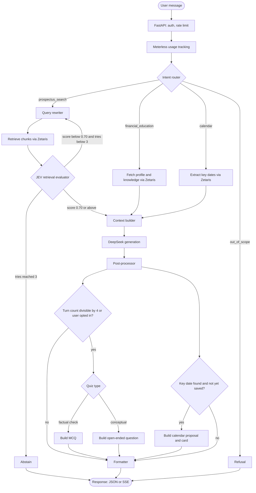
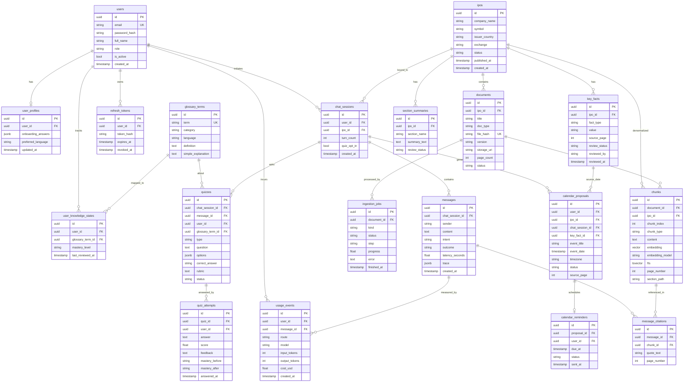

# Mostro AI

**A trustworthy, prospectus-grounded assistant that helps people in Africa understand IPOs, avoid scams, and learn about investing.**

This repository is a single FastAPI application ("monolith") that contains user management and the whole AI system: the agent, retrieval, education, calendar reminders, ingestion, and admin tooling. It is built for the **Open Agent Hackathon 2026** (GenAI.Works).

This README is the full technical documentation and is written for **coding agents and developers** working in this repo. Examiners should read [`OPEN_AGENT_HACKATHON.md`](OPEN_AGENT_HACKATHON.md) instead. Related files:

| File | Purpose |
|---|---|
| `AGENTS.md` | Short, strict rules for coding agents (must be consistent with this README) |
| `docs/api-map.md` | The complete endpoint list (method, path, params, returns). **The API contract.** |
| `OPEN_AGENT_HACKATHON.md` | Examiner guide: install, run, and test the agent |

> **Status:** active development (pre-MVP). See [Roadmap](#14-roadmap) and the "Current status" box there.

---

## Table of contents

1. [Why Mostro exists](#1-why-mostro-exists)
2. [Objectives and non-goals](#2-objectives-and-non-goals)
3. [Target population](#3-target-population)
4. [Product overview](#4-product-overview)
5. [Core design principles](#5-core-design-principles)
6. [Architecture](#6-architecture)
7. [Data model](#7-data-model)
8. [Tech stack](#8-tech-stack)
9. [Repository structure](#9-repository-structure)
10. [Getting started](#10-getting-started)
11. [Useful commands](#11-useful-commands)
12. [Configuration](#12-configuration)
13. [Testing and evaluation](#13-testing-and-evaluation)
14. [Roadmap](#14-roadmap)
15. [Conventions and contributing](#15-conventions-and-contributing)
16. [Security, privacy and compliance](#16-security-privacy-and-compliance)
17. [Glossary](#17-glossary)

---

## 1. Why Mostro exists

Large IPOs, such as the recent Dangote refinery IPO, bring many first-time investors into capital markets. With genuine interest come three problems:

- **Scams.** Fake offers, fake "agents", WhatsApp investment groups, and requests to pay into personal accounts.
- **Hard-to-find, hard-to-read information.** The official document is a prospectus of hundreds of pages in legal and financial language.
- **Skepticism.** Many people distrust anything related to investing, often for good reason.

Mostro's answer is one idea: **let people ask questions directly to the official prospectus, and show exactly where each answer comes from.** A user can verify any statement by opening the cited page. Verifiability is the product.

## 2. Objectives and non-goals

### Objectives

1. **Accurate, cited answers about one IPO**: dates, price, minimum subscription, how to apply, receiving agents and banks, use of proceeds, risks. Every answer carries citations (page, section, short quote).
2. **Explainability.** For every answer, the system can show *how it decided*: the route chosen, each retrieval attempt and its score, the sources used, and the cost. This is exposed through a trace endpoint and through log files.
3. **Personalized financial education.** Explanations adapt to the user's profile and tracked knowledge. An interactive quiz loop (multiple-choice and open-ended) reinforces learning and updates mastery.
4. **Calendar reminders.** Verified IPO dates become proposals that the user confirms, then scheduled reminders, with an `.ics` export.
5. **Honesty over fluency.** If the prospectus does not support an answer after the retrieval loop, the agent abstains.
6. **Testable from the API alone.** Every capability, plus seed data, traces, integration health, and time-travel for reminders, is reachable through HTTP routes.

### Non-goals

- **No personalized investment advice**, predictions, or guaranteed returns, ever. The agent informs and educates.
- **No live market data** in v1 (subscription levels, allotment results, listing prices). The prospectus is a snapshot, and the agent says so.
- **No trading, no real portfolio.** The "user data" store holds profile and knowledge state only.
- **No external calendar write integration** in the MVP. Reminders live in the app; `.ics` export covers other calendars.
- **Not a general chatbot.** Off-topic requests are politely refused. A chat session is bound to **one IPO**.

## 3. Target population

Primary: **first-time and early-stage retail investors across Africa**, including people skeptical of investing or targeted by scams.

| Reality | Design consequence |
|---|---|
| Many users are new to finance | Plain language, profile-adapted depth, glossary, quizzes |
| Anglophone and Francophone markets | English and French from day one; more languages later |
| Mobile-first, variable bandwidth | Short answers by default, optional streaming |
| High scam exposure | Scam-aware wording, comparison with official details |
| Low institutional trust | Every claim cites a page the user can open |
| Different regulator per country | Information and education only; never advice |

## 4. Product overview

1. A user **registers** and completes a short **onboarding** (experience, risk tolerance, goal, language).
2. The user picks **one published IPO** and opens a chat session bound to it.
3. For each message, the agent routes to one of three pipelines:
   - **Prospectus search** (agentic RAG): rewrite, retrieve, evaluate, retry up to 3 times, then answer with citations or abstain.
   - **Financial education**: explain concepts using the user's profile and mastery state.
   - **Calendar**: read verified key dates and propose calendar events.
4. After the answer, a **post-processor** may attach a **quiz** (every 4th turn, or when the user opted in) and a **calendar card** (when a key date was found and not yet saved).
5. The user can answer quizzes (mastery updates), confirm calendar proposals (reminders are scheduled), and view their **token and cost usage**.
6. **Admins** upload prospectuses, review extracted key facts, manage the glossary, and use demo and debug tools.

The complete route list is in `docs/api-map.md`.

## 5. Core design principles

1. **The prospectus is the source of truth.** The LLM explains; it does not invent. Facts come from retrieved passages or human-verified key facts.
2. **The IPO is never chosen by the model.** `ipo_id` comes from the session and is applied as a hard filter in the database query.
3. **Abstain rather than guess.** When the retrieval evaluator never reaches the threshold, the agent says it could not find support in the prospectus.
4. **Explain the decision, not just the answer.** Every step writes a structured record to the trace and to the log files.
5. **Verified data only for facts that matter.** Dates, prices, and agents feed answers and calendar proposals only when `review_status = verified`.
6. **Propose, then confirm.** The agent proposes calendar events; the user confirms.
7. **Testable by API.** Anything an examiner needs to see must be reachable by an HTTP call.
8. **Sponsor technology is real, visible, and replaceable.** Zetaris and Meterless sit behind adapters, and their use is visible in traces, logs, and health checks.
9. **Measure quality.** Evals run after every prompt, model, retrieval, or chunking change.

## 6. Architecture

### 6.1 System overview

```
Client (curl / Swagger UI / future frontend)
        │  HTTPS, JWT bearer
        ▼
┌──────────────────────────── FastAPI application ────────────────────────────┐
│ api/  routes: auth, users, ipos, chat, education, calendar, usage, admin    │
│ services/  business logic       core/  logging, errors, security            │
│ agent/  LangGraph graph  ─►  retrieval/  ─►  integrations/zetaris           │
│                          ─►  llm/  (DeepSeek chat, Voyage embeddings)       │
│                          ─►  integrations/meterless (usage + cost tracking) │
│ scheduler  (reminders)          ingestion/  (separate entrypoint)           │
└───────────────┬─────────────────────────────────────────────┬───────────────┘
                ▼                                             ▼
   PostgreSQL + pgvector (users, IPOs, chunks,         logs/  (app.log, agent.log)
   key facts, sessions, messages, quizzes, usage...)
```

There are no other services. Zetaris is used as the query layer over the data stores; DeepSeek and Voyage AI are external APIs.

### 6.2 Agent graph (LangGraph)

The agent is a **fixed graph with conditional edges**, not a free tool-calling loop. This makes it testable, debuggable, and explainable.



**Node contracts.** Every node takes the graph state and returns a partial state update. Nodes must be individually unit-testable with fakes.

| Node | Responsibility | Writes to state |
|---|---|---|
| `router` | Classify intent: `prospectus_search`, `financial_education`, `calendar`, `out_of_scope` (includes advice-seeking). Cheap model, structured output with a short reason. | `intent`, `route_reason` |
| `query_rewriter` | Turn the message plus history into a standalone search query. On retries, rewrite differently using the evaluator's feedback. | `rewritten_query`, `tries` |
| `retriever` | Hybrid search (vector + full-text, fused with RRF), filtered by `ipo_id`, executed through the Zetaris adapter. | `retrieved` (chunk id, page, section, score) |
| `jev_evaluator` | With JEV configured, evaluate evidence sufficiency using System One's Noul probability (0 to 1). Threshold `RETRIEVAL_THRESHOLD` (0.70), max tries `RETRIEVAL_MAX_ATTEMPTS` (3). Without JEV, use the deterministic similarity baseline. | evidence probability, pass/retry/abstain |
| `refusal` / `abstain` | Produce the honest "I could not find this in the prospectus" (outcome `abstained`) or the out-of-scope refusal (outcome `refused`). No generation from model knowledge. | `answer`, `outcome` |
| `edu_fetch` | Load the user's profile and knowledge states (through Zetaris). Also retrieve relevant chunks when the question concerns this IPO. | `profile`, `knowledge` |
| `calendar_extract` | Load **verified** date key facts for the IPO. | `key_dates` |
| `context_builder` | Assemble the prompt context: verified chunks or facts, user level and language, citation markers. | `context` |
| `generate` | DeepSeek call. Answers only from the context, adds `[n]` citation markers, adapts tone and language. | `answer`, `citations`, `usage` |
| `post_processor` | Decide on quiz and calendar card (rules below). Skipped when the outcome is `abstained` or `refused`. | `quiz`, `calendar_card` |
| `formatter` | Build the final response object (and SSE events when streaming), persist message, citations, quiz, proposal, trace, and usage. | `response` |

**State fields (minimum):** `user_id`, `session_id`, `ipo_id`, `message`, `history`, `turn_count`, `quiz_opt_in`, `intent`, `profile`, `knowledge`, `rewritten_query`, `tries`, `retrieved`, `jev_score`, `verdict`, `key_dates`, `context`, `answer`, `citations`, `quiz`, `calendar_card`, `outcome`, `usage`, `trace`.

### 6.3 Retrieval and the evaluator loop

1. Rewrite the query (first try uses history; later tries use the evaluator's hint).
2. Embed the query (Voyage, `input_type=query`) and run hybrid search filtered by `ipo_id` and indexed documents only. Fuse vector and full-text ranks with Reciprocal Rank Fusion, keep the top candidates, expand neighboring chunks.
3. The evaluator scores the evidence against the original task.
4. `score >= 0.70` → build context. `score < 0.70` and `tries < 3` → go back to step 1. `tries == 3` → abstain.
5. Every try is recorded in the trace (rewritten query, chunk ids, pages, scores, verdict).

> **Cost and rate-limit note:** each try costs one query embedding and one evaluator call. Voyage's free trial without a payment method is limited to 3 requests and 10K tokens per minute, so a 3-try abstention can take about a minute on that tier. Add a payment method to the Voyage account, and cache query embeddings for identical rewritten queries.

### 6.4 Education pipeline

- Inputs: `user_profiles.onboarding_answers` (experience, risk tolerance, goal), `preferred_language`, and `user_knowledge_states` (per glossary term mastery).
- The context builder tells the model the user's level and which concepts they have already mastered (so it does not over-explain) or not yet seen (so it defines them).
- General concepts come from `glossary_terms` (`definition`, `simple_explanation`), labeled as **general education**, not as prospectus content.
- **Quiz engine:**
  - Trigger: `turn_count % QUIZ_EVERY_N_TURNS == 0` or `chat_sessions.quiz_opt_in`, or an explicit request (`POST /v1/chat/sessions/{id}/quizzes`).
  - Type: factual knowledge (numbers, dates, procedures) → **MCQ**; conceptual understanding → **open-ended**. Make the rule configurable.
  - Grading: MCQ is deterministic. Open-ended is graded by the LLM against a rubric stored with the quiz, returning score, feedback, and an explanation.
  - Mastery update (proposed default): `unseen → learning` on first exposure; a correct answer promotes one level; an incorrect answer demotes at most one level; always update `last_reviewed_at`.
  - The correct answer is never returned before the quiz is answered.

### 6.5 Calendar and reminders

- Proposals are built **only from verified date key facts** (`offer_open_date`, `offer_close_date`, `allotment_date`, `listing_date`, and similar).
- A proposal is created by the agent (post-processor or calendar route) or directly (`POST /v1/ipos/{id}/calendar/proposals`).
- Flow: `proposed` → user `confirm` (with timezone and `remind_before_minutes`) → a `calendar_reminders` row is scheduled → the scheduler marks it `due` then `sent` (in-app state in the MVP).
- Timestamps always carry an explicit IANA timezone (for example `Africa/Douala`). Never use naive datetimes.
- `POST /v1/admin/reminders/run-due` runs one scheduler tick and accepts a `now` override so a tester can fast-forward time.
- `GET /v1/calendar/events.ics` exports confirmed events.

### 6.6 Ingestion pipeline

Runs as a separate entrypoint (`python -m ai.ingestion ...`) and through admin routes (which enqueue a job).

```
Upload PDF → parse (layout-aware) → section-aware chunking → embed (Voyage) → store
                      └→ key-facts extraction (LLM) → human review → publish
                      └→ section summaries (LLM) → review
```

- Chunk along headings, about 400 to 800 tokens, prepend a context header (`Issuer > Section > Subsection`) before embedding, keep tables as their own chunks, keep page numbers on everything, treat addenda as new document versions.
- Embedding calls must be **throttled** (requests and tokens per minute) and batched; see `ai/llm/rate_limit.py`.
- Key facts carry their source page and need `review_status = verified` before use. Publishing an IPO requires an indexed document and the required key facts verified.

### 6.7 Sponsor integrations

Sponsor integrations sit behind small adapters. Tests inject fakes; the agent
does not silently bypass Zetaris when the harness is missing or fails.

| Integration | Role in the system | Adapter | Observability |
|---|---|---|---|
| **Zetaris** | Required agent context harness: IPOs, chunks, learning profile/progression, history, calendar facts | `backend/app/services/zetaris.py`, `backend/app/services/agent_data.py` | `mostro.zetaris` completion logs (row/page counts and duration, no SQL or record contents), `python -m scripts.check_zetaris` |
| **Meterless** | Usage tracking around every LLM call: tokens and cost per request. | `ai/integrations/meterless/` | `meterless.usage` log events, `usage_events` table, `message.usage`, `GET /v1/usage/me` |

Rules for the adapters:
- Define a narrow interface (for example `run_chunk_search(...)`, `get_user_context(...)`, `record_usage(...)`).
- **No direct-Postgres fallback for agent context.** Missing configuration, upstream failures, malformed records or incomplete pagination produce an explicit SSE error, not fabricated context or a misleading evidence refusal.
- Queries are predefined, read-only templates with typed UUID filters, safely encoded model names, timeouts and row limits. No model-written SQL. The REST API accepts SQL text, not bind parameters.
- **Approved transaction boundary:** authentication, chat ownership/creation/counters, message/citation/calendar writes, and H-MEM state locking/ledger updates remain on PostgreSQL. All other agent context reads use Zetaris. Migrations and ingestion/indexing also remain direct database operations.
- **Connection method:** documented REST on port 8888 (`/api/v1.0`), with PostgreSQL registered as a JDBC datasource inside Zetaris. The web UI proxy on port 3000 is a different API and is not used.

#### Local Zetaris setup

The REST contract is verified against the
[official OpenAPI](https://api.saas.enterprise.zetaris.com/redoc/docs.yaml),
[knowledge-base API guide](https://kbase.zetaris.com/knowledge/accessing-zetaris-using-api),
[pagination guide](https://kbase.zetaris.com/knowledge/rest-api), and
[getting-started SQL reference](https://github.com/zetaris/getting-started/blob/main/docs/guides/zetaris-lightning-sql-commands.md).
The adapter uses:

- `POST /query/sql/start` with `{"select": "...", "pageLimit": 100}`;
- `GET /query/sql/page` with `queryToken`, `pageLimit`, `pageNumber`;
- `DELETE /query/sql/close/{queryToken}`, including after page/validation failures.

Every request includes `X-Org-ID`, a unique `X-Request-ID`, and the API key as
a bearer token. All pages are fetched and validated; `ZETARIS_MAX_ROWS` overflow
fails instead of silently truncating context. Requests that might have opened a
cursor are not blindly retried.

`ZETARIS_USERNAME` and `ZETARIS_PASSWORD` are accepted for the optional
`--login` diagnostic (`GET /auth/login` with Basic auth). The REST OpenAPI
distinguishes login idTokens from API tokens: **SQL still requires
`ZETARIS_API_KEY`**, even when username/password are configured.
Create that key through your Zetaris console and grant access only to the
agent datasource/views.

1. Apply migration `20261027_0008` before registering the views:

   ```bash
   cd backend
   uv run --env-file ../.env alembic upgrade head
   ```

   It creates seven `agent_*` PostgreSQL views. UUIDs, JSON constraints and
   pgvector embeddings are exposed as JDBC-safe strings; authentication
   secrets and H-MEM internals are not exposed. The chunk view only exposes
   indexed documents with matching chunk/document IPOs; facts must be
   verified; rejected calendar proposals do not suppress dates.

2. Ensure **both network paths** work: backend -> Zetaris API, and Zetaris
   driver -> Mostro PostgreSQL. `localhost` inside a container means that
   container, not the host or another service. The supplied Mostro and Zetaris
   compose files are separate projects, so their default networks do not
   communicate automatically.

   For existing containers, one local setup is a dedicated bridge:

   ```bash
   docker network create mostro-zetaris
   docker network connect --alias mostro-postgres mostro-zetaris <mostro-postgres-container>
   docker network connect --alias zetaris-api mostro-zetaris <zetaris-api-container>
   docker network connect mostro-zetaris <zetaris-driver-container>
   docker network connect mostro-zetaris <mostro-app-container>
   ```

   Use actual container names from `docker ps`, and run the create/connect
   commands only when the network/connections do not already exist. These
   survive restarts, but must be reapplied after container recreation (or
   declared in your deployment's compose overlays). Explicit aliases avoid
   confusing Zetaris's own `postgres` metastore with Mostro's database.
   Keep the Zetaris metastore on its own network; do not attach it here.
   For this setup, set `ZETARIS_REST_URL=http://zetaris-api:8888/api/v1.0`.
   A backend running on the host instead uses `http://localhost:8888/api/v1.0`.

3. Create a dedicated PostgreSQL login with `CONNECT` on the Mostro database,
   `USAGE` on its schema, and **SELECT only on the seven views**. Do not give
   Zetaris the application's database superuser credentials. In Zetaris's
   SQL Workspace, register the JDBC datasource using that login:

   ```sql
   CREATE DATASOURCE mostro DESCRIBE BY "Mostro agent context" OPTIONS (
     jdbcdriver "org.postgresql.Driver",
     jdbcurl "jdbc:postgresql://mostro-postgres:5432/mostro",
     username "YOUR_READ_ONLY_LOGIN",
     password "YOUR_READ_ONLY_PASSWORD",
     fetchsize "1000"
   )
   ```

   Then register the seven native PostgreSQL views through Zetaris's documented
   `CREATE DATASOURCE VIEW` command (each statement separately). This does not
   depend on whether your JDBC metadata discovery includes database views:

   ```sql
   CREATE DATASOURCE VIEW agent_ipos FROM mostro AS SELECT * FROM public.agent_ipos
   CREATE DATASOURCE VIEW agent_chunks FROM mostro AS SELECT * FROM public.agent_chunks
   CREATE DATASOURCE VIEW agent_profiles FROM mostro AS SELECT * FROM public.agent_profiles
   CREATE DATASOURCE VIEW agent_knowledge FROM mostro AS SELECT * FROM public.agent_knowledge
   CREATE DATASOURCE VIEW agent_history FROM mostro AS SELECT * FROM public.agent_history
   CREATE DATASOURCE VIEW agent_facts FROM mostro AS SELECT * FROM public.agent_facts
   CREATE DATASOURCE VIEW agent_proposals FROM mostro AS SELECT * FROM public.agent_proposals
   SHOW DATASOURCE TABLES mostro
   ```

   The names must resolve as `mostro.agent_ipos`, etc. Adjust the JDBC
   hostname/database/schema to your installation. `ZETARIS_DATASOURCE` changes
   the datasource namespace if you register it under a different name.

4. Fill the five Zetaris variables in the root `.env` (see `.env.example`),
   then run the checks from the backend directory:

   ```bash
   uv run --env-file ../.env python -m scripts.check_zetaris
   # Optional: also verify login, actual evidence, learning, history and dates.
   uv run --env-file ../.env python -m scripts.check_zetaris --login \
     --ipo-id <ipo-uuid> --user-id <user-uuid> --session-id <chat-session-uuid>
   ```

   No paid model/embedding calls are made. The check validates REST
   connectivity, all registered view columns, and Spark cosine arithmetic.
   The optional IDs exercise the real repository queries. Existing chunks
   must be embedded with the configured model first (see Voyage setup).

**Vector retrieval:** the database's pgvector `<=>` operator and HNSW index are
not available to Spark SQL. Zetaris parses the view's float-vector text and
computes cosine scores, filters by IPO/model, sorts, and returns top-k before
the REST result is read. No arbitrary first-N candidate truncation or
client-side vector scan is used. This is exact retrieval, but scans the
filtered vectors in Zetaris rather than using PostgreSQL's HNSW index; assess
latency on large corpora. Hybrid/full-text fusion remains roadmap work.
Do not cache/materialize the user-context views: subsequent turns need fresh
committed profile/progression/history data.

### 6.8 Logging and tracing

The agent must write logs to **both the console and the `logs/` folder**, so a developer or examiner can follow the agent's reasoning step by step.

**Handlers**

| Sink | Format | Content |
|---|---|---|
| Console | Pretty (`LOG_FORMAT=console`) or JSON | All events at `LOG_LEVEL` |
| `logs/app.log` | JSON lines, rotating | Everything: HTTP requests, auth events, errors, scheduler, ingestion |
| `logs/agent.log` | JSON lines, rotating | Only agent-related events (`agent.*`, `retrieval.*`, `zetaris.*`, `meterless.*`, `llm.*`) |

`logs/` is git-ignored (keep a `.gitkeep`), created at startup if missing, and mounted as a volume in Docker.

**Mandatory fields** on every event: `timestamp` (UTC ISO 8601), `level`, `event`, `logger`. Bind these when known: `request_id`, `user_id`, `session_id`, `ipo_id`, `message_id`, `node`, `try`, `duration_ms`.

**Agent event catalog** (use these names; add new ones in the same style)

| Event | Fields (besides mandatory) |
|---|---|
| `agent.run.start` / `agent.run.end` | `turn_count`, `intent`, `outcome`, `total_ms` |
| `agent.node.start` / `agent.node.end` | `node`, `duration_ms`, `decision` (short summary) |
| `agent.route.decided` | `intent`, `reason` |
| `agent.rewrite` | `try`, `original`, `rewritten` |
| `retrieval.attempt` | `try`, `top` (list of `{chunk_id, page, score}`), `via` |
| `agent.jev.verdict` | `try`, `score`, `verdict`, `reason` |
| `agent.abstain` | `tries`, `best_score` |
| `agent.context.built` | `sources`, `context_tokens`, `profile_level` |
| `llm.request.completed` / `llm.request.failed` | `provider`, `model`, `operation`, `input_tokens`, `output_tokens`, `duration_ms` |
| `agent.postprocess.quiz` | `triggered`, `reason`, `quiz_type` |
| `agent.postprocess.calendar` | `date_found`, `already_saved`, `proposal_id` |
| `zetaris.query` | `name`, `target`, `rows`, `duration_ms` |
| `meterless.usage` | `route`, `model`, `input_tokens`, `output_tokens`, `cost_usd` |

**Rules**
- Log **structured decisions with a short reason**, not raw model chain-of-thought.
- Never log passwords, tokens, API keys, or emails. A redaction processor must drop these keys.
- User message text is logged (truncated to 200 characters) only when `LOG_USER_CONTENT=true` (default `true` when `DEMO_MODE=true`, otherwise `false`). Full prompts are logged only at `DEBUG` with `LOG_PROMPTS=true`.
- The same information is stored in `messages.trace` and served by `GET /v1/chat/messages/{id}/trace`. The log files and the trace must tell the same story.

### 6.9 Model roles

| Role | Model (configurable) | Used for |
|---|---|---|
| Fast LLM | DeepSeek flash model | Router, query rewriting, evaluator |
| Main LLM | DeepSeek pro model | Generation, quiz grading, key-fact extraction, summaries |
| Embeddings | Voyage AI text embeddings (`voyage-3.5`, 1024 dimensions) | Prospectus chunks and queries |

Check the provider docs for current model names before changing them (DeepSeek renamed its models in 2026). If the embedding model or dimension changes, **every vector must be re-embedded** and the `VECTOR(n)` columns migrated. Voyage supports 2048 dimensions, but pgvector cannot HNSW-index plain `vector` columns above 2000 dimensions, so stay at 1024.

## 7. Data model

The authoritative schema is the Alembic migrations. `ai_service_schema.sql` is the older baseline and **must be updated** to match this section. Keep from the baseline: the `fts` generated column and GIN index, `chunk_type`, `chunk_index`, the HNSW index, and the accent-insensitive text search configuration.



Notes:
- `chunks.ipo_id` is denormalized on purpose: retrieval filters on it directly. Only chunks of `indexed` documents are searchable.
- `calendar_proposals.chat_session_id` is nullable (direct proposals have no chat).
- `messages.trace` holds the agent trace; `usage_events` holds per-call tokens and cost.
- Dates in `key_facts.value` are ISO strings with timezone.
- `mastery_level` values: `unseen`, `learning`, `familiar`, `mastered` (to be confirmed).

## 8. Tech stack

| Concern | Choice |
|---|---|
| Language and tooling | Python 3.12, [uv](https://docs.astral.sh/uv/), ruff, mypy, pytest |
| API | FastAPI, Uvicorn, Pydantic v2, `pydantic-settings`, SSE (`sse-starlette`), `python-multipart` |
| Auth | JWT (`pyjwt`), password hashing (`pwdlib[argon2]`), OAuth2 password form for Swagger |
| Agent | LangGraph, `langchain-core`, `langchain-deepseek` |
| LLM | DeepSeek |
| Embeddings | Voyage AI over HTTP (`httpx`), adapter in `backend/app/services/embeddings.py` |
| Database | PostgreSQL 17, pgvector (HNSW), full-text search |
| DB access | SQLAlchemy 2 (async), psycopg 3, Alembic |
| Scheduler | APScheduler (reminders) |
| Calendar export | `icalendar` |
| Ingestion | Docling, PyMuPDF (optional `ingest` dependency group), `tiktoken` |
| Resilience and logging | `tenacity`, `structlog` |
| Data layer sponsor | Zetaris |
| Usage tracking sponsor | Meterless |
| Agent memory | Local Python implementation of Meterless H-MEM (separate from token tracking and evidence retrieval) |
| Tests | pytest, pytest-asyncio, httpx, respx |
| Packaging | Docker (multi-stage), Docker Compose |
| Dev environment | Cursor (with `AGENTS.md`) |

## 9. Repository structure

The project has two main sub‑folders at the repository root:
- **frontend/** – a Next.js application that builds a static web UI.
- **backend/** – the FastAPI service that implements the agent, retrieval, and APIs.

The Dockerfile performs a multi‑stage build: it first builds the Next.js app, then copies the generated static assets into the FastAPI image, which serves them.


The Python package is `ai`. Adjust paths if it lives under `src/`.

```text
Mostro-AI-OAH/
├── README.md                     # main documentation
├── OPEN_AGENT_HACKATHON.md       # examiner guide
├── AGENTS.md                     # coding agent rules
├── env.example                   # example env file
├── Dockerfile, docker-compose.yml, .dockerignore, .gitignore
├── schema-for-agent.sql
├── api-map-draft.md
├── backend/
│   ├── alembic.ini
│   ├── pyproject.toml, uv.lock
│   ├── Dockerfile, docker-compose.yml, .dockerignore
│   ├── alembic/                 # migrations
│   ├── logs/                    # runtime logs
│   ├── data/demo/               # demo IPO data
│   ├── docs/
│   │   └── api-map.md
│   ├── scripts/                 # utility scripts
│   └── app/
│       ├── __init__.py
│       ├── main.py
│       ├── config.py
│       ├── core/
│       ├── db/
│       ├── deps/
│       ├── models/
│       ├── schemas/
│       ├── services/
│       ├── api/
│       │   ├── deps.py
│       │   ├── routes/
│       │   └── schemas/
│       └── agent/
│           ├── state.py
│           ├── graph.py
│           └── nodes/
├── frontend/
│   ├── README.md
│   ├── app/
│   │   ├── layout.tsx
│   │   ├── page.tsx
│   │   ├── login/
│   │   ├── register/
│   │   ├── verify-email/
│   │   └── globals.css
│   ├── components/
│   ├── lib/
│   ├── public/
│   ├── next.config.ts
│   ├── package.json
│   ├── package-lock.json
│   ├── tsconfig.json
│   ├── AGENTS.md
│   └── Dockerfile
```

### Layering rules

- **Direction:** `api → services → agent → retrieval / integrations / llm → db`. Nothing imports upward.
- **Provider code lives in `ai/llm/` and `ai/integrations/` only.** No `httpx` calls to DeepSeek, Voyage, Zetaris, or Meterless anywhere else.
- **Retrieval SQL lives in `ai/retrieval/` and the Zetaris queries only**, and always takes `ipo_id` from the caller, never from model output.
- **Routes contain no business logic.** Routes validate input, call a service, and shape the response.
- **Ingestion is its own entrypoint** with heavier dependencies.
- **Prompts are files**, versioned; the prompt version is stored in the trace.

## 10. Getting started

### Prerequisites

Python 3.12, [uv](https://docs.astral.sh/uv/), Docker and Docker Compose, and API keys for DeepSeek and Voyage AI (plus Zetaris and Meterless credentials when you test those integrations).

### First-time setup

```bash
# 1. Install dependencies (add --extra ingest to run ingestion locally)
uv sync

# 2. Configure the environment
cp env.example .env              # fill in the keys; see section 12

# 3. Start Postgres with pgvector
docker compose up -d db

# 4. Apply migrations
uv run alembic upgrade head

# 5. Verify connectivity (database, embeddings, LLM, integrations)
uv run --env-file .env python scripts/smoke_check.py

# 6. Run the API (DEMO_MODE=true seeds demo data on startup)
uv run --env-file .env uvicorn ai.main:app --reload
```

Open `http://localhost:8000/docs`. Logs appear in the console and in `logs/`.

If you are starting without a `pyproject.toml`:

```bash
uv init --package ai && cd ai
uv add fastapi "uvicorn[standard]" pydantic-settings sse-starlette python-multipart email-validator \
       structlog tenacity orjson tiktoken httpx pyjwt "pwdlib[argon2]" apscheduler icalendar
uv add langgraph langchain-core langchain-deepseek
uv add "sqlalchemy[asyncio]" "psycopg[binary,pool]" pgvector alembic
uv add --group dev pytest pytest-asyncio respx ruff mypy pre-commit
uv add --optional ingest docling pymupdf
```

### Known gotchas

- **Voyage rate limits.** Limits depend on your account and model. The adapter retries HTTP 429, 5xx and transport failures with bounded backoff and honors `Retry-After` (up to 60 seconds; longer waits fail explicitly). It does not provide a cross-process rate limiter. Reduce `EMBEDDING_BATCH_SIZE` for lower token limits or unusually long chunks.
- **Demo seed must not call the embedding API.** `data/demo/` ships precomputed embeddings with the same model and dimension as the config. If you change the embedding model, regenerate them.
- **Docker log folder permissions.** The container runs as a non-root user. Run `mkdir -p logs && chmod 777 logs` before `docker compose up` so it can write to the bind mount.
- **Embedding dimension is fixed in the column type.** `EMBEDDING_DIMENSION` is validated as 1024. Supporting another dimension requires a schema/index migration and re-embedding.

### Voyage embeddings in the current backend

The implementation follows Voyage's [text embedding API](https://docs.voyageai.com/reference/embeddings-api)
and [retrieval guidance](https://docs.voyageai.com/docs/embeddings).
Set `EMBEDDING_API_KEY` in the root `.env`; `EMBEDDING_API_URL` defaults to
`https://api.voyageai.com/v1/embeddings` (origin and `/v1` base URLs also work).
The default model remains `voyage-3.5` to avoid silently changing the embedding
space. This adapter accepts text, not multimodal PDF/image payloads.

Queries use `input_type="query"`; stored chunks use `input_type="document"`,
with issuer and section context prepended. The adapter requests float output,
disables silent truncation, batches document inputs, and validates response
counts, indices, model, dimensions, and finite non-zero vectors. Voyage enforces
per-text context and aggregate batch token limits; oversized inputs fail
explicitly rather than producing partial or truncated evidence.

Apply migration `20261027_0007` **before starting the updated backend**, then
re-embed each existing document. Unknown-model vectors intentionally remain
unsearchable until re-embedded; retrieval only searches vectors whose
`chunks.embedding_model` matches `EMBEDDING_MODEL`.

From the repository root, using the backend environment:

```bash
# DATABASE_URL and EMBEDDING_API_KEY must be configured.
cd backend
uv run --env-file ../.env alembic upgrade head
uv run --env-file ../.env python -m scripts.embed_document <document-uuid>
```

The command operates on chunks already in PostgreSQL; PDF parsing/chunking is
not part of this entrypoint. It replaces all vectors for one document in a
single transaction, records their model, and leaves document review/status
unchanged. A provider failure rolls back instead of leaving partially updated
vectors. Changing `EMBEDDING_MODEL` requires re-running this command for every
document. Do not label old vectors with a model name without regenerating them.
Repeated identical rewritten queries reuse their vector within one retrieval
request, without retaining user text in a global cache. Local H-MEM feature
hashing remains separate from Voyage prospectus evidence retrieval.

Run the isolated, mocked provider/retrieval tests without PostgreSQL, Redis,
or paid API calls:

```bash
cd backend
PYTEST_DISABLE_PLUGIN_AUTOLOAD=1 uv run python -m pytest -p pytest_asyncio.plugin \
  --confcutdir=tests/unit tests/unit/test_embeddings.py tests/unit/test_jev.py -q
```

## 11. Useful commands

### Run and debug

```bash
uv run --env-file .env uvicorn ai.main:app --reload       # API with hot reload
curl http://localhost:8000/health                         # liveness
curl http://localhost:8000/v1/meta                        # versions, thresholds, integrations
```

### Logs (see section 6.8)

```bash
tail -f logs/agent.log                                    # follow the agent step by step
tail -f logs/agent.log | jq -c '{event, node, try, score, verdict, duration_ms}'
grep '"message_id": "<ID>"' logs/agent.log | jq .         # everything for one answer
jq -r 'select(.level=="error")' logs/app.log              # errors only
```

### Database

```bash
docker compose up -d db                                   # start Postgres + pgvector
docker compose down -v                                    # stop and delete all data
docker compose exec db psql -U ai -d ai_service           # SQL shell
uv run alembic revision --autogenerate -m "describe"      # create a migration
uv run alembic upgrade head                               # apply
uv run alembic downgrade -1                               # roll back one
```

### Ingestion and demo data

```bash
uv run --env-file .env python -m ai.ingestion run <document_id>      # parse, chunk, embed
uv run --env-file .env python scripts/seed_demo.py                   # load demo data manually
```

### Quality

```bash
uv run ruff check . && uv run ruff format .               # lint and format
uv run mypy ai                                            # type check
uv run pytest tests/unit                                  # fast tests, no network
uv run pytest tests/integration                           # needs the database
uv run pytest tests/e2e                                   # full examiner flow on the demo IPO
uv run --env-file .env python scripts/run_eval.py         # evals
```

### Docker

```bash
mkdir -p logs && chmod 777 logs
docker compose up --build                                 # db + migrations + API
docker compose logs -f api                                # console logs
docker build --target ingest -t mostro-ai-ingest .        # ingestion image
```

## 12. Configuration

All configuration comes from environment variables, read only in `ai/config.py`. Copy `env.example` to `.env`. Never commit `.env`.

| Variable | Purpose | Default / example |
|---|---|---|
| `ENV` | `dev`, `test`, `prod` | `dev` |
| `DEMO_MODE` | Seed demo data on startup, enable demo and debug admin routes, log user content | `true` for the hackathon, `false` in production |
| `DATABASE_URL` | Postgres connection | `postgresql+psycopg://ai:ai@localhost:5432/ai_service` |
| `LOG_LEVEL` | Minimum level | `INFO` |
| `LOG_FORMAT` | Console format: `console` or `json` | `console` |
| `LOG_DIR` | Folder for log files | `logs` |
| `LOG_FILE_MAX_MB`, `LOG_FILE_BACKUPS` | Rotation | `20`, `5` |
| `LOG_USER_CONTENT` | Log truncated user text | `true` in demo mode |
| `LOG_PROMPTS` | Log full prompts at DEBUG | `false` |
| `JWT_SECRET` | JWT signing key | long random string |
| `ACCESS_TOKEN_TTL_MINUTES`, `REFRESH_TOKEN_TTL_DAYS` | Token lifetimes | `30`, `7` |
| `ADMIN_BOOTSTRAP_EMAIL`, `ADMIN_BOOTSTRAP_PASSWORD` | Admin account created at startup | demo only |
| `DEMO_USER_EMAIL`, `DEMO_USER_PASSWORD` | Demo user created by the seed | demo only |
| `DEEPSEEK_API_KEY`, `DEEPSEEK_BASE_URL` | LLM access | `https://api.deepseek.com` |
| `LLM_MODEL_FAST`, `LLM_MODEL_MAIN` | Router/evaluator vs generation models | check provider docs |
| `EMBEDDING_API_KEY` | Voyage bearer API key | unset |
| `EMBEDDING_API_URL` | Voyage text embedding endpoint (origin and `/v1` base also accepted) | `https://api.voyageai.com/v1/embeddings` |
| `EMBEDDING_MODEL` | Text embedding model; re-embed documents when changed | `voyage-3.5` |
| `EMBEDDING_DIMENSION` | Fixed to match the current `VECTOR(1024)` schema | `1024` |
| `EMBEDDING_BATCH_SIZE` | Maximum texts per request (1-1000); also respect Voyage token limits | `32` |
| `EMBEDDING_MAX_ATTEMPTS` | Bounded attempts per HTTP request (1-6) | `3` |
| `MODEL_TIMEOUT_SECONDS` | Shared provider HTTP timeout | `60` |
| `JEV_ENDPOINT` | Enable JEV intent routing and evidence evaluation; accepts the full endpoint, API origin, or `/v1` base | unset; example: `https://api.typesafe.ai/v1/systemone` |
| `JEV_API_KEY` | TypeSafe bearer API key for both routing and evaluation | unset |
| `JEV_MODEL` | System One model alias | `jev-latest` |
| `HMEM_ENABLED` | Enable local H-MEM capture, recall and governance APIs; apply migration `20261027_0006` first | `true` |
| `RETRIEVAL_THRESHOLD` | Evidence sufficiency probability required to answer | `0.70` |
| `RETRIEVAL_MAX_ATTEMPTS` | Retrieval attempts before abstaining | `3` |
| `QUIZ_EVERY_N_TURNS` | Quiz cadence | `4` |
| `RETRIEVAL_CANDIDATES`, `RERANK_TOP_K` | Retrieval sizes | `30`, `6` |
| `MESSAGE_RATE_LIMIT_PER_MINUTE` | Per-user limit on message endpoints | `20` |
| `ZETARIS_REST_URL` | Required agent harness; REST origin or `/api/v1.0` base, not UI proxy | unset; host example `http://localhost:8888/api/v1.0` |
| `ZETARIS_ORG_ID` | Numeric organization ID | unset |
| `ZETARIS_API_KEY` | Required bearer API token for SQL | unset |
| `ZETARIS_USERNAME`, `ZETARIS_PASSWORD` | Optional Basic-auth login diagnostic; not SQL-token substitutes | unset |
| `ZETARIS_DATASOURCE` | Registered namespace containing the seven `agent_*` views | `mostro` |
| `ZETARIS_TIMEOUT_SECONDS` | Timeout per REST request | `60` |
| `ZETARIS_PAGE_SIZE` | SQL records per page, 1-100 | `100` |
| `ZETARIS_MAX_ROWS` | Fail rather than truncate results above this bound | `10000` |
| `METERLESS_ENABLED`, `METERLESS_BASE_URL`, `METERLESS_API_KEY` | Usage tracking | <!-- TODO: confirm --> |

## 13. Testing and evaluation

Language-model systems fail silently, so we measure.

1. **Unit tests**: nodes with fake LLMs and fake retrievers, JEV loop logic (retry, abstain, pass), quiz trigger rules, mastery updates, calendar proposal rules, rank fusion, auth, log redaction. Fast, no network.
2. **Integration tests**: real Postgres with pgvector, mocked HTTP for DeepSeek, Voyage, Zetaris, and Meterless (`respx`). Tests must never call paid APIs.
3. **End-to-end test** (`tests/e2e/`): automates the examiner flow in `OPEN_AGENT_HACKATHON.md` against the demo IPO (register, ask with citations, abstention, education adaptation, calendar confirm and reminder fast-forward, quiz answer, usage). **This test must pass before any submission.**
4. **Evals** (`evals/`): a golden set per IPO (factual, table-based, multi-page, unanswerable), plus trap sets: advice-seeking, scam messages, prompt injection, questions about another IPO, French and code-switched queries, calendar edge cases (time zones, past dates).

Metrics: retrieval recall@k and MRR, answer faithfulness, citation correctness, abstention correctness, **average evaluator tries**, route accuracy, quiz grading agreement, cost per answer.

### JEV integration checks

The backend sends `model`, `state`, and named `questions` to the
[System One API](https://docs.typesafe.ai/api/system-one). Intent routing uses
Choice; retrieval uses Noul to ask whether the passages explicitly answer the
original question. Noul is a probability of sufficient evidence, not a relevance
rating or a separate confidence value. Query rewrites only affect retrieval,
not the question evaluated by JEV.

Set `JEV_ENDPOINT`, `JEV_API_KEY`, and optionally `JEV_MODEL` in `.env`.
Leaving `JEV_ENDPOINT` unset or empty selects keyword routing and similarity
evaluation. A configured JEV service failure produces an agent error; it never
silently falls back to those baselines. Only the routing message and, for
evaluation, the query and retrieved passages are sent to TypeSafe.

Run the isolated, mocked-HTTP contract and retrieval-loop tests without
Postgres, Redis, or paid API calls:

```bash
cd backend
uv run --extra dev pytest --confcutdir=tests/unit tests/unit/test_jev.py
```

These tests verify payloads, bearer authentication, endpoint normalization,
response validation, threshold boundaries, retry/refusal behavior, and error
propagation. They do not measure the live model's routing or judgment accuracy.

### Meterless H-MEM

The backend implements the [H-MEM architecture](https://github.com/Meterless/Meterless/tree/main/engines/hmem),
following its `AGENTS.md` and runnable reference at upstream revision
`70ca80fe88ad8d27288501e8dd08b091ed38c095`. H-MEM is **not** a hosted metering
API. It runs locally and needs no Meterless key, proxy, or separate Node service.
Existing request logging/token reporting is independent of this integration.

Apply the migration before starting the updated backend:

```bash
cd backend
uv run alembic upgrade head
```

Set `HMEM_ENABLED=false` to retain the pre-memory agent path. By default:

- Each authenticated user has their own versioned state in `hmem_states`;
  chat and IPO (`missionId`) scope prevent unrelated-session recall. Optional
  goal-run scoping is supported by the engine. Unscoped records can be shared
  only inside the same user's state.
- Memories retain confidence, source, typed provenance, entities, namespace,
  tier, access statistics, peer links, replacement edges, and synthesis lineage.
  Embeddings and legacy provenance are backfilled during hydration; malformed
  or sourceless state is rejected rather than silently discarded.
- The agent mines user messages/corrections and completed model responses,
  recalls previous memories, and injects domain-grouped context into generation.
  `answer.memory_trace` identifies the strategy, retrieval reason, memory IDs
  and relevance scores.
- Recall uses the canonical weighted formula, a final-score threshold of
  **0.35**, and at most **5** memories. Recency decays with a **14-day** time
  constant. Superseded records are penalized by **0.20**, not deleted.
- Helpful feedback adds **0.05** confidence and one access; not-helpful subtracts
  **0.03**; wrong subtracts **0.20** and adds `review`. Confidence stays in [0, 1].
- Contradictions are recorded and queued. Auto-resolution is an explicit action
  gated at decision confidence **0.70**. Human resolution supports keeping
  either/both, merging, or retiring both. Losing records remain auditable.
- Dreaming creates proposals only. Human approval is required before an insight
  or invariant becomes long-term memory; rejected proposals create no memory.
- Sleep requires a fresh reviewed preview, creates a durable backup, then
  consolidates stale short-term records (**7 days**), archives unreferenced
  low-access records (**30 days**, access count <= **2**), and synthesizes eligible
  groups (cosine >= **0.82**). Current replacements, derived records, graph hubs,
  and pending-review sources are protected. Restore preserves the audit ledger.

**Evidence boundary:** memory is unverified personalization, including remembered
model responses. It cannot satisfy JEV's evidence gate, provide prospectus
citations, or authorize calendar dates. Verified retrieval runs independently
before memory reinjection.

**Hackathon deployment choices:** all tiers are checkpointed in Postgres for
request/worker continuity, with `short_term` session-scoped rather than held in
a process-global map. Memory plus audit writes share a transaction; a per-user
row lock prevents lost updates (concurrent streams from that user serialize).
The local 64-dimensional feature-hash embedder mirrors the reference's lightweight
approach; it is not the Voyage/pgvector evidence embedder. Default mining is
deterministic direct capture, with an optional model-extraction hook and a logged
fallback on malformed/unavailable extraction. Dreaming/sleep are explicit
operations, not unattended background jobs. Large-scale memory indexing and a
dedicated frontend memory dashboard are not included.

Authenticated API surfaces (the API's existing bearer authentication applies):

| Endpoint | Purpose |
|---|---|
| `GET /memory` | Inspect memories, tier/domain health counts, proposals, conflicts and maintenance reports |
| `POST /memory/events` | Capture `chat_message`, `user_correction`, `file_save`, `file_open`, `file_edit`, `model_response`, or `plan_completion`; requires an owned `chatId` |
| `POST /memory/{id}/feedback` | Submit `{"kind":"helpful"}`, `not_helpful`, or `wrong` |
| `DELETE /memory/{id}` | Remove an active memory while retaining its audit history |
| `POST /memory/dream` | Generate pending proposals |
| `POST /memory/proposals/{id}/review` | Approve/reject with `{"approve":true}` or `false` |
| `POST /memory/conflicts/scan` | Detect contradictions |
| `POST /memory/conflicts/{id}/resolve` | Human resolution with `strategy` and, for merge, `content` |
| `POST /memory/conflicts/{id}/auto-resolve` | Apply the decision-confidence gate or leave queued |
| `GET /memory/sleep/preview` | Read-only maintenance plan |
| `POST /memory/sleep` | Execute `{"operation":"execute","plan":...}` or restore `{"operation":"restore","backupId":"..."}` |
| `GET /memory/ledger` | Paginated append-only audit export; optional `memory_id`, `after_id`, and `limit` |

For file/document capture, pass `documentName` alongside a file event; input is
capped at 8,000 characters and facts enter the working tier. There is no editor
file watcher or document-upload service in this backend, so those producers call
the event endpoint explicitly. HTTP/agent errors are not silently converted to
successful memory operations.

Run local memory and existing agent regressions without paid APIs:

```bash
cd backend
uv run --extra dev pytest --confcutdir=tests/unit tests/unit tests/test_agent_logic.py
```

The Postgres integration tests skip unless `HMEM_TEST_DATABASE_URL` names a
**disposable test database**, where they create and remove uniquely named test
schemas. With it set, they verify the migration in both directions, persistence
across repository instances, concurrent writes, owner isolation, API feedback
and approval, backup/restore, and a two-turn agent recall flow.

To run Meterless's actual TypeScript conformance runner against the Python engine,
check out the upstream revision above and run from this repository's backend:

```bash
export PYTHONPATH="$PWD"
export HMEM_PYTHON="$PWD/.venv/bin/python"
export HMEM_IMPL="$PWD/tests/unit/hmem_adapter.ts"
npx --yes --package tsx tsx /path/to/Meterless/engines/hmem/conformance/runner.ts
```

The adapter only translates calls/JSON: the Python engine executes every operation.
All **13 upstream checks** pass; local tests additionally cover exact ranking
arithmetic, scoping, maintenance protection, restore, and database/agent integration.

**Rule:** run the evals after every change to a prompt, model, threshold, retrieval setting, or chunking.

## 14. Roadmap

Ordered by risk: data and retrieval first, features after. Tier labels match `docs/api-map.md` (C = core, S = support, X = stretch).

> **Current status:** the backend has a Voyage text embedding adapter with document batching, bounded retries, response validation, model-scoped retrieval, and an existing-chunk indexing command (see above). Full PDF ingestion and cross-process rate limiting remain open. The roadmap below also includes planned components.

- [ ] **Phase 0: Foundation.** `config.py`, `core/logging.py` (console + `logs/app.log` + `logs/agent.log`, redaction), errors, middleware (request id, access log), DB session, Alembic baseline from section 7, `/health`, `/v1/meta`.
- [ ] **Phase 1: Auth and users.** Register, login, token, refresh, logout, `users/me`, profile, onboarding questions. Admin bootstrap. *Needed by every other route.*
- [ ] **Phase 2: LLM and embedding layers.** DeepSeek client, Voyage client with batching and throttling, Meterless usage wrapper, fakes for tests.
- [ ] **Phase 3: Ingestion and data.** Parse, chunk, embed, store; key-fact extraction with review routes; section summaries; admin IPO and document routes; demo data package in `data/demo/` with precomputed embeddings; demo seed.
- [ ] **Phase 4: Retrieval and evaluator.** Zetaris REST context reads and exact vector retrieval are implemented without direct fallback. Hybrid search/RRF, the retrieval debug route and retrieval evals remain.
- [ ] **Phase 5: Agent graph v1.** Router, rewriter, retriever, evaluator loop, abstain, refusal, context builder, generate, formatter. Chat routes (`ask`, sessions, messages), trace route, agent logging. *First end-to-end slice.*
- [ ] **Phase 6: Education.** Edu route, glossary routes, knowledge states, quiz engine (on-trigger and on-demand), grading, mastery updates.
- [ ] **Phase 7: Calendar.** Calendar route and direct proposals, confirm/reject, reminders, scheduler, `run-due` time travel, `.ics`.
- [ ] **Phase 8: Observability and testability.** `usage` routes, `integrations/health`, demo reset, full examiner flow e2e test.
- [ ] **Phase 9: Evals and polish.** Eval suites and optional eval routes (X), French checks, performance, final `OPEN_AGENT_HACKATHON.md` review.

**Minimum shippable demo:** phases 0 to 5, plus the Zetaris and Meterless integrations visible in traces and usage. Beyond v1: more languages (Swahili, Hausa, Yoruba, Pidgin, Arabic), more countries, WhatsApp channel, a source for live announcements, external calendar integration.

## 15. Conventions and contributing

### For coding agents

- Read this README, `AGENTS.md`, and `docs/api-map.md` before changing anything. The API map is the contract: change it in the same commit as the route.
- Build in roadmap order and tier order. Do not start a phase while the previous one's checks fail.
- Run `ruff check`, `ruff format --check`, `mypy ai`, and the relevant `pytest` targets before declaring a task done, and report the results.
- If requirements are ambiguous or conflict with a rule here, stop and ask instead of guessing.
- Ask before: adding dependencies, changing the API contract, changing the embedding model or dimension, destructive schema changes, deleting evals.

### Code

- Type hints everywhere; async for I/O; Pydantic models across boundaries (API schemas, graph state, repository returns).
- Graph nodes are small functions: state in, partial state out. No hidden global state.
- Every LLM and embedding call has a timeout, retries (`tenacity`), throttling where limits apply, and logs provider, model, duration, and tokens.
- Use `get_logger(__name__)` from `ai/core/logging.py`. Event names are dotted, lowercase (`agent.jev.verdict`). Every agent node logs `agent.node.start` and `agent.node.end`. Follow the redaction and content rules in section 6.8.
- Calendar datetimes carry explicit IANA time zones.
- Errors are typed (`ai/core/errors.py`) and mapped to the error shape in the API map. An abstention is a `200`, not an error.
- Schema changes go through Alembic. Prompts live in `ai/agent/prompts/` and are versioned; changing one means running the evals.

### Hard rules

1. `ipo_id` never comes from model output. It comes from the session.
2. Provider and sponsor code stays in `ai/llm/` and `ai/integrations/`.
3. Zetaris queries are predefined, parameterized, read-only. No model-written SQL.
4. Only verified key facts feed answers and calendar proposals.
5. Never weaken the evaluator threshold, the abstention path, or the refusal path to make a test pass.
6. No investment advice, predictions, or guaranteed-return wording anywhere, including prompts and fixtures.
7. Never log or commit secrets. Never expose a quiz's correct answer before it is answered.
8. Tests must not call paid or external APIs.

### Workflow

Short-lived branches, small pull requests, clear commit messages. <!-- TODO: confirm commit convention --> CI runs lint, types, and tests; it must pass before merge.

## 16. Security, privacy and compliance

- **Authentication.** Short-lived JWT access tokens and revocable, hashed refresh tokens. Passwords hashed with Argon2. Admin routes require the `admin` role.
- **Authorization.** Users only access their own sessions, messages, quizzes, proposals, reminders, and usage. Return `404` for resources of other users where existence should not leak.
- **Isolation.** Retrieval is filtered by the session's `ipo_id`. A session is bound to one IPO for life.
- **Rate limiting.** Per user on message endpoints, since they cost money.
- **Demo tooling.** Seed, reset, retrieval debug, and time-travel routes exist only when `DEMO_MODE=true`. Demo credentials are for the hackathon only and must be changed or removed in any real deployment.
- **Information, not advice.** The product must never give personalized recommendations or promise returns. Disclaimers and wording need legal review per country.
- **Scam wording.** Say things like "this account is not listed among the receiving agents on page X" and tell users to confirm through official channels. Never state with certainty that something is or is not a scam.
- **Prompt injection.** Prospectus text and user messages are untrusted data. The model never chooses the IPO, never writes SQL, and never executes actions.
- **Personal data.** User messages may contain personal details. DeepSeek and Voyage are external APIs hosted outside most users' regions; prospectus text is public, user messages are not. Review data-handling obligations per country. Users can delete their account and all associated data (`DELETE /v1/users/me`).
- **Logs.** Redact secrets and emails. Log user text only when allowed by configuration.
- **Secrets.** Environment variables or a secret manager; never committed, never baked into images.

## 17. Glossary

| Term | Meaning |
|---|---|
| **IPO** | Initial Public Offering: a company sells shares to the public for the first time |
| **Prospectus** | The official legal document describing the offer, the company, the risks, and how to subscribe |
| **Addendum** | An official amendment to a prospectus, ingested as a new document version |
| **Allotment** | Deciding how many shares each applicant receives |
| **Oversubscription** | More shares requested than offered |
| **Receiving agent** | An authorized institution that collects applications and payments |
| **Chunk** | A piece of the prospectus (text or table) stored with its embedding, page, and section |
| **Embedding** | A numeric vector representing the meaning of text, used for similarity search |
| **Hybrid search** | Vector similarity combined with full-text keyword search |
| **RRF** | Reciprocal Rank Fusion: a simple way to merge two ranked result lists |
| **Agentic RAG** | Retrieval-augmented generation where the agent evaluates its own retrieval and retries with a better query |
| **JEV evaluator** | The graph node that scores whether retrieved evidence is sufficient for the task (threshold 0.70, max 3 tries) |
| **Abstention** | Declining to answer because the sources do not support one (`outcome: abstained`) |
| **Refusal** | Declining an out-of-scope or advice-seeking request (`outcome: refused`) |
| **Intent** | The route chosen by the router: `prospectus_search`, `financial_education`, `calendar`, `out_of_scope` |
| **Key fact** | A structured value (such as the offer closing date) with its source page and a review status |
| **Verified** | A key fact or summary a human reviewed; only verified items feed answers and proposals |
| **Mastery level** | The user's tracked understanding of a glossary term |
| **Quiz** | An MCQ or open-ended question generated after an answer or on demand |
| **Calendar proposal** | A suggested event built from a verified date, confirmed or rejected by the user |
| **Reminder** | A scheduled notification created when a proposal is confirmed |
| **Trace** | The structured record of how one answer was produced, served by the trace route and mirrored in `logs/agent.log` |
| **Zetaris** | Sponsor data platform used as the query layer over the data stores |
| **Meterless** | Sponsor technology used here for usage and cost tracking around LLM calls |
| **SSE** | Server-Sent Events, the optional streaming format for chat responses |
| **Demo mode** | `DEMO_MODE=true`: seeds demo data and enables test and debug routes |
